# FPP-Net

### Cross-Domain Stator Fault Detection in Permanent-Magnet Synchronous Motors

**A lightweight frequency-position-preserving network with traceable cross-motor and cross-load evaluation protocols.**

[中文文档](README_zh.md) · [Dataset documentation](data/README.md) · [Evaluation protocol](docs/PROTOCOL.md) · [Validation record](docs/VALIDATION.md)

This repository accompanies the manuscript:

> **Cross-Domain Stator Fault Detection in Permanent-Magnet Synchronous Motors Using a Lightweight Frequency-Position-Preserving Network**  
> Chunpeng Liu, Xiaorui Dong, Yuze Guo, Huayu Wang, and Zekai Lin

**Correspondence:** [dongxr@sdipct.edu.cn](mailto:dongxr@sdipct.edu.cn)  
**Status:** Manuscript and reproducibility materials; no publication DOI has been assigned.

## Overview

Reliable PMSM stator fault detection requires models to work when the monitored motor or load differs from the training conditions. This project combines data-quality assessment, construction of fixed cross-domain evaluation tasks, and a compact diagnostic network.

The repository provides:

- **KAIST-XM:** a cross-motor binary detection task built from 18 acquisition-configuration-consistent vibration records.
- **CEITEC-XL:** a cross-load binary detection task built from 56 current records with measured-speed window screening.
- **FPP-Net:** relative spectral preprocessing, a compact convolutional encoder, and a frequency-position-preserving readout.
- **Reproducibility assets:** fixed partitions, original-file hashes, 18 trained checkpoints, held-out predictions, and supplementary analysis code.

These are derived evaluation tasks based on public measurements, not newly acquired datasets. Original sources and attribution are listed in [NOTICE.md](NOTICE.md).

## Method

```mermaid
flowchart LR
    A[Raw signal window] --> B[Mean removal and Hann window]
    B --> C[FFT power and fixed frequency grid]
    C --> D[Relative log-power spectrum]
    D --> E[Local spectral residual]
    D --> F[Concatenate and scale]
    E --> F
    F --> G[Two compact convolution blocks]
    G --> H[Local pooling: 64 ordered positions]
    H --> I[Flatten and position-specific readout]
    I --> J[Fault probability]
```



The frontend operates independently on each window and requires no healthy reference from the target domain. Relative scaling reduces sensitivity to common amplitude gains, while the ordered readout retains the location of spectral patterns.

| Configuration | Raw channels | Spectral input | Parameters per model |
|---|---:|---|---:|
| KAIST-XM | 1 | `2 × 1024` | 17,210 |
| CEITEC-XL | 3 | `6 × 1024` | 17,434 |

The final evaluation averages probabilities from three independently trained seeds. Parameter counts above refer to **one model**, not the complete ensemble.

## Datasets and results

| Dataset | Generalization task | Records | Retained windows | Window-level BA | Record-level BA |
|---|---|---:|---:|---:|---:|
| KAIST-XM | Unseen motor | 18 | 10,800 | 57.38% | 75.00% |
| CEITEC-XL | Unseen load group | 56 | 6,717 | 96.47% | 100.00% |

**BA** is balanced accuracy: the mean of healthy and faulty recall. Results are equal-weight means over three target folds, using three-seed probability averaging. A record decision averages all eligible window probabilities in that record; a score greater than 0.5 means faulty, with ties assigned to healthy.

### KAIST-XM

The source release contains duplicate healthy records, acquisition-channel/fault-setting confounding, and a highly similar repeating waveform across a separate acquisition group. KAIST-XM counts each healthy acquisition once and selects the 18 January 25, 2022 `ai3` vibration records.

- Three motors: **1.0, 1.5, and 3.0 kW**.
- **3 healthy and 15 faulty records**; interturn and intercoil faults are merged into one positive class.
- Sampling rate: **25.6 kHz**; window length: **5120 samples / 0.2 s**.
- Outer evaluation: **leave one motor out**.
- The 3 kW subset contains interturn faults only; this is not a three-class fault-type task.

Selection controls the identified between-group channel/date differences; it does not certify that all remaining acquisition effects are absent.

### CEITEC-XL

- One dual-three-phase PMSM, eight loads from **0 to 35 N·m**.
- **8 healthy and 48 faulty records**, with one to six emulated shorted turns.
- Three `SubSys1` currents sampled at **10 kHz**.
- Window length: **1710 samples / 0.171 s**.
- A window is retained only when **every measured speed sample** lies within **500–4000 rpm**.
- Training, validation, and test loads are disjoint; complete records remain in one partition.

Most records retain 120 windows. The 5 N·m/one-turn record retains 121, and the 35 N·m/five-turn and six-turn records retain 118 each. These differences follow the same speed-screening rule.

## Quick start

Run all commands from the repository root. **Python 3.11** is recommended.

### 1. Install dependencies

```bash
python -m venv .venv
```

Activate the environment:

```powershell
# Windows PowerShell
.\.venv\Scripts\Activate.ps1
```

```bash
# Linux / macOS
source .venv/bin/activate
```

```bash
python -m pip install -r requirements.txt
```

CPU inference is supported. For GPU execution, install a compatible PyTorch CUDA wheel before the requirements if necessary. The archived experiment environment used **PyTorch 2.8.0+cu129**; consult the [official installation instructions](https://pytorch.org/get-started/locally/) for the appropriate wheel.

### 2. Obtain the prepared data

Once published, the repository's **Releases** section should contain:

| Asset | Purpose | Approximate size |
|---|---|---:|
| `kaist-xm-processed-v1.zip` | Main KAIST-XM task | 82 MB |
| `ceitec-xl-processed-v1.zip` | Main CEITEC-XL task | 152 MB |
| `kaist-audit-features-v1.zip` | Additional 45-record acquisition-group checks | 13 MB |

Extract the first two archives **at the repository root**. They create:

```text
data/processed/
├── kaist/
│   ├── record_00.npz
│   └── ...
└── ceitec/
    ├── record_00.npz
    └── ...
```

The archives contain **final spectral input tensors, labels, record IDs, and original sample coordinates**, not the original TDMS/MAT waveforms. The tensors go directly into `FPPNet.forward`; do not apply spectral preprocessing a second time.

### 3. Verify and evaluate

```bash
python run.py check
python run.py evaluate --device cpu
```

The evaluator loads the released checkpoints, checks agreement with archived per-seed predictions, and saves fold metrics and predictions under `outputs/`.

Expected record-level BA: **KAIST-XM 75.00%**, **CEITEC-XL 100.00%**.

## Rebuild from original measurements

```bash
python run.py download --dataset kaist --raw-dir data/raw
python run.py download --dataset ceitec --raw-dir data/raw
python run.py prepare --dataset all --raw-dir data/raw
python run.py check
```

Downloads run sequentially. KAIST's official ZIP archives contain multiple modalities and are substantially larger than the selected vibration subset. If downloading manually, place the extracted source files anywhere below `data/raw/`; preparation locates exact filenames and verifies hashes.

Original sources:

- [KAIST: Mendeley Data, version 5](https://doi.org/10.17632/rgn5brrgrn.5)
- [CEITEC: Zenodo, version 1.0](https://doi.org/10.5281/zenodo.13889418)

See [data/README.md](data/README.md) for the array schema, preprocessing precision, selection criteria, and attribution.

## Training

```bash
python run.py train --dataset all --device cuda --out outputs/training
python run.py evaluate --index outputs/training/index.json --device cuda --out outputs/retrained
```

Default configuration:

| Setting | Value |
|---|---|
| Seeds | 20261014, 20261015, 20261016 |
| Epoch budget | 120 |
| Minibatches per epoch | 16 |
| Windows per minibatch | 96 |
| Optimizer | Adam, learning rate 0.001, no weight decay |
| Schedule | Cosine, 120-epoch horizon, minimum learning rate 0.00001 |
| Sampling | Uniform class → uniform record → uniform window |
| Validation | Every 10 epochs, using source domains only |

For **KAIST-XM**, the two source motors alternate as inner validation domains; the selected epoch is used to refit both source motors. For **CEITEC-XL**, source validation loads select a checkpoint and are never fitted. All jobs run sequentially, with one numerical CPU thread.

A development-only smoke run:

```bash
python run.py train --dataset kaist --fold 0 --seed 20261014 --epochs 1 --device cpu --out outputs/smoke
```

Smoke-run results are not paper results. Hardware and library differences can affect retraining; use the frozen checkpoints to recover the archived results. Do not select models or thresholds using target-fold scores.

## Baselines and supplementary analyses

### Spectral classical baselines

```bash
python run.py baseline --method lr --out outputs/lr
python run.py baseline --method svm --out outputs/svm
```

Available methods: `lr`, `svm`, `rf`, `ridge`, `gb`, and `lightgbm`. For LightGBM:

```bash
python -m pip install -r requirements-optional.txt
python run.py baseline --method lightgbm --out outputs/lightgbm
```

This compact repository implements FPP-Net and these six spectral classical baselines. The complete 15-pipeline comparison and ablation tables are archived in `results/paper_tables/`; the other neural comparator and MiniRocket training implementations are not included here.

### Acquisition-group and partition checks

Extract `kaist-audit-features-v1.zip` at the repository root, then run:

```bash
python supplementary.py
```

| Protocol | Window BA | Record BA |
|---|---:|---:|
| 45 records, random 80/20 window split | 98.83% | — |
| 45 records, leave-one-motor-out fault detection | 49.87% | 48.81% |
| 38 records, leave-one-motor-out A/B group recognition | 86.87% | 85.71% |
| 18 group-A records, leave-one-motor-out fault detection | 59.60% | 63.89% |

The random split shares acquisitions between training and test. The all-record cross-motor detector identifies 41/42 faulty records but falsely flags all three healthy records. Group predictability does not by itself isolate the causal effect of channel/date because fault settings also differ between groups.

### Frequency-position diagnostics

```bash
python run.py explain --device cuda --out outputs/explanation
```

Each target fold is analyzed only with its own three frozen models. The output includes normalized readout weight norms and absolute probability changes after zeroing individual 16-bin input bands.

| Diagnostic | KAIST-XM | CEITEC-XL |
|---|---:|---:|
| Positions accounting for half of the norm | 26/64 | 27/64 |
| Weight-norm / occlusion-profile correlation | 0.409 | 0.713 |

These diagnostics describe distributed frequency sensitivity. They do not identify physical fault harmonics or establish causal importance from weight magnitude alone.

## Repository structure

```text
FPP-Net/
├── README.md / README_zh.md
├── LICENSE / NOTICE.md / CITATION.cff
├── fpp_net.py                 # Independent frontend and model
├── run.py / workflow.py       # Preparation, training and evaluation
├── supplementary.py          # Acquisition-group/split checks
├── checkpoints/              # 18 final models and index
├── configs/splits.json        # Frozen window-index partitions
├── data/
│   ├── manifests/            # Record metadata and source hashes
│   ├── sources/              # Download and license metadata
│   └── processed/            # Extracted Release assets; Git-ignored
├── results/                  # Reference predictions and paper tables
├── docs/                     # Protocol, validation and publishing guide
└── tests/                    # Lightweight core checks
```

## Validation and interpretation

```bash
python -m unittest discover -s tests -v
```

Packaging checks include reconstruction of all 74 main-task records from original files, matching feature hashes, frozen-checkpoint prediction replay, LR baseline reproduction, supplementary-analysis replay, and a training smoke test. See [docs/VALIDATION.md](docs/VALIDATION.md).

KAIST-XM has one healthy record per motor, and benchmark test folds were inspected during method development. Accordingly, these results describe the supplied evaluation tasks and do not replace independent confirmation on new acquisitions. Windows from the same record are not independent experimental repetitions.

## License and citation

- **Software:** [MIT](LICENSE).
- **Original measurements and derived data:** CC BY 4.0, with original creators, source DOIs, and processing changes documented in [NOTICE.md](NOTICE.md).
- **Citation:** use [CITATION.cff](CITATION.cff) for this project and also cite the original datasets. No manuscript publication DOI is asserted.

For publishing this prepared repository and its data assets, follow [the GitHub upload guide](docs/UPLOAD_GITHUB_zh.md).
