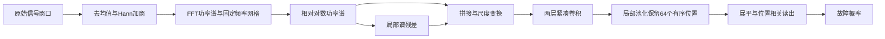

# FPP-Net：永磁同步电机跨域定子故障检测

**结合可追溯数据制备、跨电机/跨负载评估与轻量化频率位置保持网络的研究项目。**

[English](README.md) · [数据说明](data/README.md) · [评估协议](docs/PROTOCOL.md) · [GitHub上传步骤](docs/UPLOAD_GITHUB_zh.md)

对应论文稿件：

> **Cross-Domain Stator Fault Detection in Permanent-Magnet Synchronous Motors Using a Lightweight Frequency-Position-Preserving Network**

作者：Liu Chunpeng、董晓睿、国宇泽、王华宇、林泽凯。  
通讯邮箱：[dongxr@sdipct.edu.cn](mailto:dongxr@sdipct.edu.cn)。  
目前为稿件配套材料，尚未填写期刊发表信息或论文DOI。

## 项目简介

永磁同步电机定子故障检测不仅需要识别已见工况，还需要适应不同电机与负载。本项目基于公开实测数据构建两个固定的跨域评估任务，并提出轻量化频率位置保持网络FPP-Net。

项目提供三部分内容：

1. **KAIST-XM与CEITEC-XL评估数据集**：明确记录选择、窗口制备、标签与跨域划分，保留原始文件和处理结果的校验信息。
2. **FPP-Net及训练预测代码**：相对对数功率谱与局部谱残差、紧凑卷积编码器、有序读出及三模型概率平均。
3. **可复现材料**：18个最终检查点、逐窗口测试概率、传统基线、采集组/划分核查与频率解释实验。

两个任务均由原作者公开测量派生，并非本项目重新采集的数据。原作者署名、数据DOI和处理变更见 [NOTICE.md](NOTICE.md)。

## 模型结构



预处理逐窗口独立完成，不需要目标电机的健康参考。相对尺度化降低共同幅值增益的影响；有序读出保留局部谱模式出现的频率位置。

| 数据集 | 原始通道数 | 网络输入 | 单模型参数量 |
|---|---:|---|---:|
| KAIST-XM | 1 | `2 × 1024` | 17,210 |
| CEITEC-XL | 3 | `6 × 1024` | 17,434 |

论文最终结果使用三个随机种子模型的概率平均；上述参数量指单模型，不是整个集成。

## 数据集与主要结果

| 数据集 | 跨域任务 | 记录数 | 窗口数 | 窗口级BA | 记录级BA |
|---|---|---:|---:|---:|---:|
| KAIST-XM | 跨电机 | 18 | 10,800 | 57.38% | 75.00% |
| CEITEC-XL | 跨负载 | 56 | 6,717 | 96.47% | 100.00% |

BA为健康召回率与故障召回率的平均值。表中结果采用三种子概率集成，再对三个目标折等权平均。记录级判决先平均该记录全部有效窗口的概率，再以0.5为阈值；恰好等于0.5时归为健康。

### KAIST-XM

源数据中识别到健康记录重复、采集通道与故障设置混杂，以及另一采集组中跨电机高度相似的重复波形。本任务对重复健康测量只计一次，并选取2022年1月25日、`ai3`通道的18条振动记录。

- 电机额定功率：1.0、1.5、3.0 kW。
- 3条健康、15条故障；匝间和线圈间故障合并为正类。
- 采样率25.6 kHz，窗口5120点，即0.2 s。
- 留一电机测试，其余两台电机作为源域。
- 3 kW所选记录中不含线圈间故障，因此本任务是健康/故障二分类，不是故障类型三分类。

该选择控制已识别的组间通道与日期差异，不意味着剩余记录已被证明不存在其他采集因素。

### CEITEC-XL

- 一台双三相PMSM，负载为0–35 N·m，共八档。
- 8条健康、48条故障，模拟1–6匝短路。
- 使用三个`SubSys1`相电流，采样率10 kHz。
- 窗口1710点，即0.171 s。
- 仅保留窗口内**全部实测转速均在500–4000 rpm**的窗口。
- 按完整记录与负载划分，训练、验证和测试负载互不重叠。

多数记录保留120窗；5 N·m/1匝记录保留121窗；35 N·m/5匝与6匝记录各保留118窗。这些差异由统一转速筛选规则产生。

## 快速复现

以下命令均在仓库根目录执行，建议使用Python 3.11。

### 1. 安装依赖

```bash
python -m venv .venv
```

激活虚拟环境：

```powershell
# Windows PowerShell
.\.venv\Scripts\Activate.ps1
```

```bash
# Linux / macOS
source .venv/bin/activate
```

```bash
python -m pip install -r requirements.txt
```

CPU可直接预测。使用GPU时，可先安装适合显卡的PyTorch CUDA版本；原实验使用PyTorch 2.8.0+cu129，安装方式参考 [PyTorch官网](https://pytorch.org/get-started/locally/)。

### 2. 准备数据

维护者发布后，可从仓库Releases下载：

| 文件 | 用途 | 大小约 |
|---|---|---:|
| `kaist-xm-processed-v1.zip` | KAIST-XM主任务 | 82 MB |
| `ceitec-xl-processed-v1.zip` | CEITEC-XL主任务 | 152 MB |
| `kaist-audit-features-v1.zip` | 45条记录的采集组核查 | 13 MB |

将前两个附件解压到**仓库根目录**，形成：

```text
data/processed/
├── kaist/record_00.npz ...
└── ceitec/record_00.npz ...
```

附件提供最终频谱输入、标签、记录ID和原始窗口坐标，不是原始TDMS/MAT波形。频谱张量直接输入`FPPNet.forward`，不要再次做频谱预处理。

### 3. 检查与预测

```bash
python run.py check
python run.py evaluate --device cpu
```

程序检查数据数量、哈希和划分，读取冻结模型，并与保存的逐种子预测比较。输出位于`outputs/`。

预期记录级BA：**KAIST-XM 75.00%，CEITEC-XL 100.00%**。

## 从原始波形重建

```bash
python run.py download --dataset kaist --raw-dir data/raw
python run.py download --dataset ceitec --raw-dir data/raw
python run.py prepare --dataset all --raw-dir data/raw
python run.py check
```

下载按顺序执行。KAIST官方压缩包包含多种模态，下载体积明显大于本项目所选振动子集。也可以从原平台手动下载，把解压后的文件放在`data/raw/`下；程序按准确文件名查找并校验哈希。

原始数据：

- [KAIST：Mendeley Data，第5版](https://doi.org/10.17632/rgn5brrgrn.5)
- [CEITEC：Zenodo，第1.0版](https://doi.org/10.5281/zenodo.13889418)

详细字段、处理精度和选择规则见 [data/README.md](data/README.md)。

## 重新训练

```bash
python run.py train --dataset all --device cuda --out outputs/training
python run.py evaluate --index outputs/training/index.json --device cuda --out outputs/retrained
```

| 设置 | 值 |
|---|---|
| 随机种子 | 20261014、20261015、20261016 |
| 训练预算 | 120轮 |
| 每轮批次 | 16 |
| 每批窗口 | 96 |
| 优化器 | Adam，初始学习率0.001，无权重衰减 |
| 学习率调度 | 120轮余弦调度，最小学习率0.00001 |
| 采样方式 | 类别均匀 → 记录均匀 → 窗口均匀 |
| 验证 | 每10轮，仅使用源域 |

KAIST轮流留出两台源电机做内部验证，选定轮次后在两台源电机上重新训练；CEITEC用源验证负载选择检查点，验证负载不参与拟合。数值CPU线程数为1，训练任务顺序执行。

仅检查运行流程时，可以使用：

```bash
python run.py train --dataset kaist --fold 0 --seed 20261014 --epochs 1 --device cpu --out outputs/smoke
```

1轮流程检查不是论文实验。硬件与库版本可能影响重新训练结果；复现归档成绩应使用冻结检查点。不得根据测试域分数选择轮次、种子或阈值。

## 基线与补充实验

### 传统基线

```bash
python run.py baseline --method lr --out outputs/lr
python run.py baseline --method svm --out outputs/svm
```

支持`lr / svm / rf / ridge / gb / lightgbm`。使用LightGBM时：

```bash
python -m pip install -r requirements-optional.txt
python run.py baseline --method lightgbm --out outputs/lightgbm
```

本精简仓库实现FPP-Net及六种谱特征传统基线；完整15流程对比和消融结果表位于`results/paper_tables/`。其他神经网络对照与MiniRocket的训练实现不包含在本次精简发布中。

### 采集组与划分核查

解压第三个数据附件后运行：

```bash
python supplementary.py
```

| 协议 | 窗口级BA | 记录级BA |
|---|---:|---:|
| 45条记录，随机80/20窗口划分 | 98.83% | — |
| 45条记录，留一电机故障检测 | 49.87% | 48.81% |
| 38条记录，跨电机A/B采集组识别 | 86.87% | 85.71% |
| 18条A组记录，留一电机故障检测 | 59.60% | 63.89% |

随机划分共享采集记录。全记录跨电机检测虽然检出41/42故障，但3/3健康均误报。采集组可预测也不等于已经独立识别通道或日期的因果影响，因为故障设置同时存在组间差异。

### 频率位置解释

```bash
python run.py explain --device cuda --out outputs/explanation
```

每个目标折只使用属于该折的三个模型分析对应留出窗口，统计读出权重范数及16频点频带置零后的概率变化。

| 指标 | KAIST-XM | CEITEC-XL |
|---|---:|---:|
| 累计半数范数所需位置 | 26/64 | 27/64 |
| 范数与遮挡效应分布的相关系数 | 0.409 | 0.713 |

结果描述模型的分布式频率敏感性，不直接确定物理故障谐波，也不把权重大小等同于因果贡献。

## 目录结构

```text
FPP-Net/
├── README.md / README_zh.md
├── LICENSE / NOTICE.md / CITATION.cff
├── fpp_net.py                 # 独立预处理与网络
├── run.py / workflow.py       # 数据制备、训练、评估
├── supplementary.py          # 采集组与划分核查
├── checkpoints/              # 18个最终模型
├── configs/splits.json        # 固定窗口级索引划分
├── data/
│   ├── manifests/            # 记录清单与哈希
│   ├── sources/              # 原始下载与许可元数据
│   └── processed/            # Release解压目录，Git忽略
├── results/                  # 参考预测和论文结果表
├── docs/                     # 协议、验证和上传说明
└── tests/                    # 核心检查
```

## 验证与结果解释

```bash
python -m unittest discover -s tests -v
```

已验证74条主任务记录从原始文件重建后的特征哈希、冻结模型概率重放、LR基线、补充实验与训练流程。详细记录见 [docs/VALIDATION.md](docs/VALIDATION.md)。

KAIST每台电机只有一条健康记录，开发过程中也查看过基准测试折。这里的成绩描述所提供评估任务上的表现，不能替代新的独立采集验证；同条记录的多个窗口不能视为多次独立实验。

## 许可与引用

- 软件代码：[MIT许可](LICENSE)。
- 原始测量及派生数据：CC BY 4.0，须保留原作者署名、源DOI、许可链接和处理变更说明，详见 [NOTICE.md](NOTICE.md)。
- 引用本项目可使用 [CITATION.cff](CITATION.cff)，并同时引用两个原始数据集。尚未声称论文已经发表或分配DOI。

仓库及数据附件的上传方法见 [GitHub上传说明](docs/UPLOAD_GITHUB_zh.md)。
